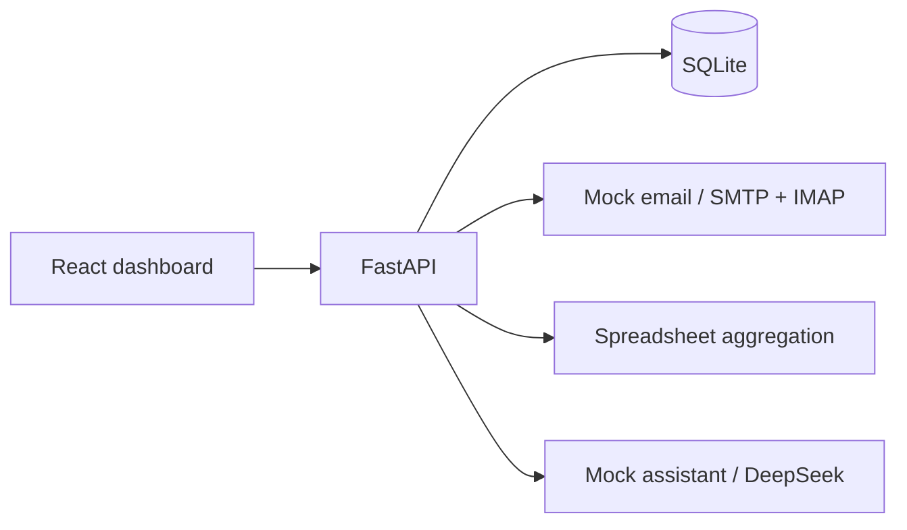

# Academic Data Hub

A course-built workspace for collecting, tracking, and aggregating academic data — with a React interface, a FastAPI backend, and optional email / LLM integrations.

`React` · `FastAPI` · `SQLAlchemy` · `SQLite` · `Python`

Built for the 2025 Database Systems course at Renmin University of China. Previously named `RUC_DB_Proj`.

## What it does

- Manage departments, teachers, and collection tasks.
- Send templates and track submissions through email workflows.
- Merge returned spreadsheets into a single report.
- Explore records and draft messages with an optional AI assistant.



## Start locally

Backend, from the repository root:

```bash
cd backend
python3 -m venv .venv
source .venv/bin/activate
pip install -r requirements.txt
cp .env.example .env
uvicorn app.main:app --host 127.0.0.1 --port 8000 --reload
```

Frontend, in a second terminal:

```bash
cd frontend
npm ci
npm run dev -- --host 127.0.0.1
```

Open http://127.0.0.1:5173. API documentation: http://127.0.0.1:8000/docs.

The example configuration enables mock email and the mock assistant. Real email sending and model calls require your own configuration; credentials are not needed to start in mock mode. SQLite tables are created when the backend starts. The current database path is fixed in `backend/app/database.py`; `DATABASE_URL` is not implemented.

## Try a small demo

1. In the local API documentation, run `POST /init_db` to initialize departments.
2. Add two fictional teachers, or import [the sample CSV](docs/examples/teachers.csv).
3. Create a collection task with a spreadsheet template.
4. Use mock email mode to inspect the workflow without sending real mail.
5. Review task progress and explore the assistant.

Local course prototype: authentication and production deployment hardening are outside this version's scope.

## Explore the code

| Path | Purpose |
| --- | --- |
| `frontend/src/components/` | Dashboard, task management, teacher management, assistant |
| `backend/app/routers/` | API endpoints |
| `backend/app/services/` | Email, spreadsheet and LLM services |
| `docs/er_and_user_manual.md` | Data model and usage notes |

[中文完整说明](docs/User-Guide.zh-CN.md) · [Example configuration](backend/.env.example)

## Project status

Course project preserved as a portfolio example. Useful next steps are automated smoke tests, a reproducible demo recording, and configurable database connections. Repository licensing has not yet been specified in a root license file.
